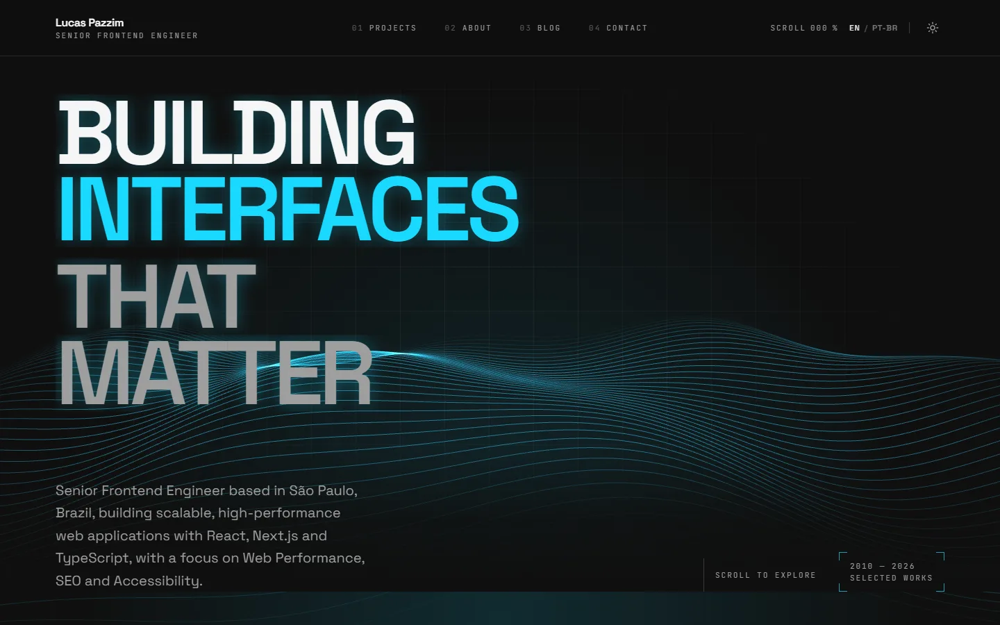
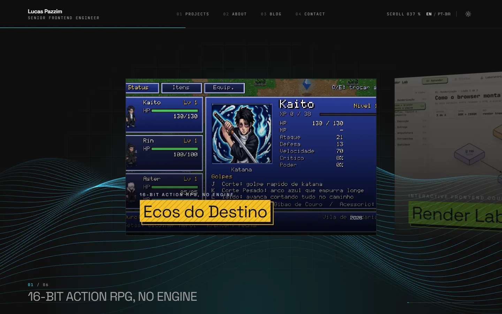
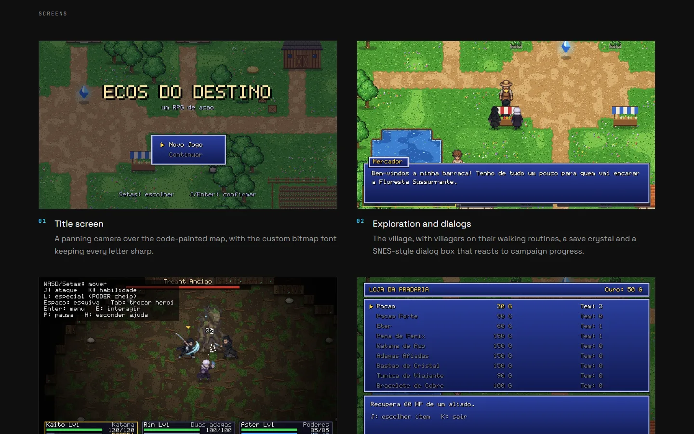
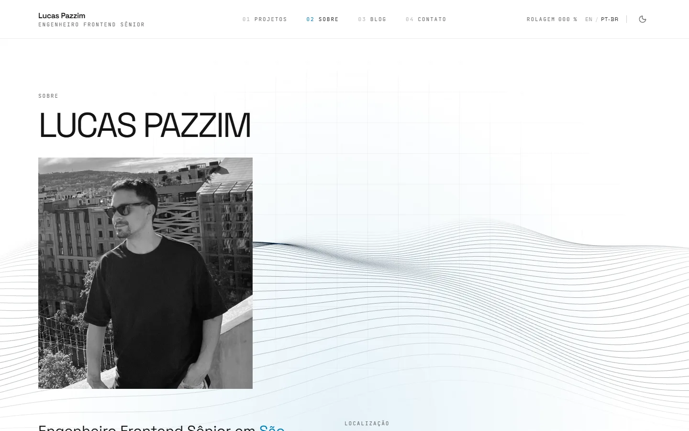
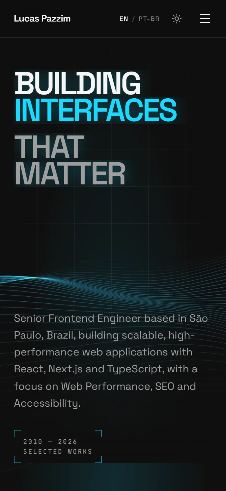

<div align="center">

# lpazzim.com

**Portfólio e CV vivo de Lucas Pazzim, Engenheiro Frontend Sênior, e um laboratório prático dos fundamentos de frontend.**
<br />
_Portfolio and living CV of Lucas Pazzim, Senior Frontend Engineer, and a hands-on lab for frontend fundamentals._

[](https://github.com/lpazzim/web-site/actions/workflows/ci.yml)


🌐 **[lpazzim.com](https://lpazzim.com)** · [LinkedIn](https://www.linkedin.com/in/lpazzim) · [GitHub](https://github.com/lpazzim)

[**🇧🇷 Português**](#-português) · [**🇺🇸 English**](#-english) · [**📸 Screenshots**](#-screenshots--capturas-de-tela)

</div>

---

## 📸 Screenshots / Capturas de tela

| Home: hero com fundo WebGL / _WebGL hero_ | Projetos em destaque: carrossel 3D / _3D featured carousel_ |
| :---------------------------------------: | :---------------------------------------------------------: |
|   |             |

| Página de case com CTAs / _Case study hero_ |        Galeria do case / _Case gallery_        |
| :-----------------------------------------: | :--------------------------------------------: |
|     |  |

|      Português + tema claro / _Portuguese, light theme_      |                                    Mobile                                     |
| :----------------------------------------------------------: | :---------------------------------------------------------------------------: |
|  |  |

---

# 🇧🇷 Português

## Sobre o projeto

O **lpazzim.com** é o meu portfólio e CV vivo: experiência profissional, cases detalhados, projetos pessoais e um blog,
em inglês e português.

Ele também é um **projeto para estudar e visualizar na prática os conceitos fundamentais de frontend**. Cada decisão do
site é uma aplicação real de um conceito, medida e protegida por testes:

- **Renderização**: SPA vs. pre-render estático, hidratação e por que o HTML gerado no build precisa ser idêntico ao
  primeiro render no navegador.
- **Performance**: LCP, code splitting, carregamento sob demanda de WebGL e animações que não bloqueiam o conteúdo
  acima da dobra.
- **SEO**: HTML completo por página, canonical, `hreflang`, Open Graph, JSON-LD, sitemap e 404 com status real.
- **Acessibilidade**: HTML semântico, foco visível, navegação por teclado, contraste AA testado nos dois temas e
  respeito a `prefers-reduced-motion`.
- **Internacionalização**: idioma na URL (`/` e `/pt`) e conteúdo tipado, em que uma tradução faltando quebra os testes.
- **Qualidade**: TypeScript estrito, testes unitários e e2e, CI em todo push e um fluxo de trabalho preparado para
  agentes de IA.

## Destaques

- **Pre-render de todas as páginas** nos dois idiomas: crawlers e previews de link (LinkedIn, WhatsApp) recebem HTML
  completo, sem servidor em runtime.
- **Identidade visual "tech HUD"**: fundo de linhas de contorno em WebGL (three.js), carrossel 3D guiado pelo scroll,
  transições de página com a View Transitions API e capas generativas determinísticas.
- **Blog com Notion como CMS headless**, acessado só no servidor e no build: o token nunca chega ao navegador.
- **LCP mobile de 5,1 s para 2,1 s** (perfil Pixel 7, CPU 4x mais lenta, 4G simulado) e CLS 0, depois de mover as
  animações acima da dobra para CSS.

## Stack

| Camada         | Tecnologia                                                  | Papel no projeto                                                                             |
| :------------- | :---------------------------------------------------------- | :------------------------------------------------------------------------------------------- |
| **UI**         | React 19 + React Compiler                                   | Componentes funcionais com memoização automática, sem `useMemo`/`useCallback` manuais.       |
| **Framework**  | React Router 8 (framework mode, `ssr: false` + `prerender`) | Rotas por idioma, `meta` por página, loaders executados no build e HTML estático por URL.    |
| **Build**      | Vite 8 (Rolldown), TypeScript 6 `strict`, Node 24, pnpm     | Build rápido, tipagem estrita em app, API, testes e ferramentas.                             |
| **Estilo**     | Tailwind CSS v4 com tokens CSS-first                        | Design tokens em `src/index.css` para os temas claro e escuro, cantos retos por design.      |
| **Animação**   | `motion` + CSS + View Transitions API                       | Animações guiadas pelo scroll, sempre respeitando `prefers-reduced-motion`.                  |
| **3D**         | `three` + `@react-three/fiber`                              | Fundo WebGL só no cliente, em chunk separado, carregado depois da hidratação.                |
| **Dados**      | TanStack Query, loaders de rota, Notion API                 | Blog pré-renderizado no build e atualizado no cliente.                                       |
| **i18n**       | i18next                                                     | Inglês em `/` e português em `/pt`, com strings de UI e conteúdo de CV tipados.              |
| **API**        | Vercel Functions (`api/`)                                   | Endpoints do blog com validação de entrada e erros genéricos para o cliente.                 |
| **Testes**     | Vitest + Testing Library, Playwright                        | Unitários (jsdom e node), e2e em desktop e mobile, crawl de SEO do sitemap.                  |
| **Qualidade**  | ESLint 10, Prettier, GitHub Actions, Dependabot             | Format, lint, typecheck, testes com cobertura, build, e2e e auditoria de dependências no CI. |
| **Hospedagem** | Vercel                                                      | Arquivos estáticos de `build/client` com cache imutável e headers de segurança.              |

## Decisões de arquitetura

As decisões completas, com contexto e consequências, estão em [`docs/decisions.md`](docs/decisions.md). Resumo:

| Decisão                                                 | Por quê                                                                                                                                                                    | Alternativa descartada                                  |
| :------------------------------------------------------ | :------------------------------------------------------------------------------------------------------------------------------------------------------------------------- | :------------------------------------------------------ |
| **Pre-render estático com React Router framework mode** | A SPA servia o mesmo HTML vazio para toda URL, prejudicando SEO e previews de link. O pre-render entrega HTML completo mantendo o deploy estático e o código React + Vite. | Reescrever em Next.js ou Astro.                         |
| **Idioma na URL (`/` e `/pt`)**                         | Com o idioma no `localStorage`, a versão em português era invisível para buscadores e não podia ser compartilhada.                                                         | Detecção pelo navegador e preferência salva.            |
| **Conteúdo tipado e bilíngue no repositório**           | Cada campo é `Localized<T>`; tradução faltando vira falha de teste e o conteúdo é revisado em PR.                                                                          | CMS para os dados do CV.                                |
| **Notion como CMS do blog, só no servidor**             | Escrevo onde já faço anotações, sem outro CMS para hospedar; o token fica em Vercel Functions e no build.                                                                  | Chamar a API do Notion no cliente.                      |
| **Render determinístico**                               | Sem `window`, `Date.now()` ou `Math.random()` durante o render: o HTML do build é igual ao primeiro render, e o e2e falha em qualquer erro de hidratação.                  | Corrigir mismatches caso a caso.                        |
| **React Compiler em vez de memoização manual**          | Memoização consistente sem ruído; o ESLint aponta o que o compilador não consegue otimizar.                                                                                | `useMemo`/`useCallback` espalhados.                     |
| **WebGL só no cliente e sob demanda**                   | O canvas nunca está no HTML pré-renderizado, então não há mismatch, e o chunk de ~900 KB fica fora do caminho crítico. O fallback é um grid em CSS.                        | Fundo animado em vídeo ou carregado no primeiro render. |
| **Animações acima da dobra em CSS**                     | Um estado `initial` do motion vai para o HTML e esconde o conteúdo até a hidratação. Em CSS, o LCP mobile caiu de 5,1 s para 2,1 s.                                        | Animações de entrada com motion.                        |
| **Capas generativas com semente**                       | Imagens consistentes e sem licença, geradas por funções puras para não quebrar a hidratação; o mesmo gerador cria a imagem de Open Graph.                                  | Fotos de banco de imagens.                              |
| **Poucas dependências**                                 | Sem UI kit, biblioteca de estado ou CSS-in-JS; tema e ícones de marca próprios. Bundle menor e menos risco de supply chain.                                                | shadcn completo, `next-themes`, pacotes de ícones.      |
| **Contraste e qualidade como testes**                   | O contraste dos tokens (4,5:1) é um teste unitário; o CI roda format, lint, typecheck, testes, build e e2e com crawl de SEO.                                               | Revisão manual.                                         |

## Estrutura

```text
api/                 Vercel Functions (API do blog); api/_lib é código compartilhado, não roteado
shared/              Tipos compartilhados entre api/ e src/
src/
  root.tsx           Documento <html>, providers, script de tema e ErrorBoundary
  routes.ts          Tabela de rotas: cada página existe em inglês (/) e português (/pt)
  routes/            Páginas: componente, meta e loaders de build
  content/           Dados do CV tipados e bilíngues (experiência, cases, perfil)
  components/        Layout, Header, Footer, carrossel, galeria, renderizador do Notion
  components/tech/   Identidade visual: fundo WebGL, intro, HUD, capas generativas
  i18n/              Idioma pela URL, LocaleLink e strings de UI (en, pt-BR)
  lib/               SEO, lista de páginas para pre-render e sitemap, cliente do blog
  theme/             Tema claro/escuro persistido
e2e/                 Playwright: fluxos, animações e crawl de SEO sobre o build
scripts/             Pós-build, imagem de Open Graph e vídeos de capa dos cases
docs/                Decisões de arquitetura e capturas de tela
```

## Como rodar

Requer Node.js 24+ e [pnpm](https://pnpm.io).

```sh
pnpm install
cp .env.example .env   # preencha as credenciais do Notion (opcional)
pnpm dev               # http://localhost:5000, servindo também /api/*
```

Sem as credenciais do Notion o site continua compilando, com um post de exemplo no blog.

| Comando           | Descrição                                                 |
| :---------------- | :-------------------------------------------------------- |
| `pnpm dev`        | Servidor de desenvolvimento (cliente + API)               |
| `pnpm build`      | Pre-render de todas as páginas em `build/client`          |
| `pnpm preview`    | Serve o build com o fallback de SPA, como na Vercel       |
| `pnpm typecheck`  | Gera os tipos das rotas e checa todo o projeto            |
| `pnpm lint`       | ESLint                                                    |
| `pnpm format`     | Prettier                                                  |
| `pnpm test`       | Testes unitários (Vitest)                                 |
| `pnpm test:e2e`   | Testes e2e e de SEO com Playwright sobre o build          |
| `pnpm og`         | Regera a imagem de Open Graph a partir da arte generativa |
| `pnpm video <id>` | Renderiza o vídeo de capa de um case                      |

---

# 🇺🇸 English

## About the project

**lpazzim.com** is my portfolio and living CV: professional experience, detailed case studies, personal projects and a
blog, in English and Portuguese.

It is also a **project to study and visualize core frontend engineering concepts in practice**. Every decision on the
site is a real application of a concept, measured and protected by tests:

- **Rendering**: SPA vs. static pre-rendering, hydration, and why the HTML produced at build time must match the first
  browser render.
- **Performance**: LCP, code splitting, on-demand WebGL and animations that never hold back above-the-fold content.
- **SEO**: complete HTML per page, canonical URLs, `hreflang`, Open Graph, JSON-LD, a sitemap and a real 404 status.
- **Accessibility**: semantic HTML, visible focus, keyboard navigation, AA contrast tested in both themes and
  `prefers-reduced-motion` support.
- **Internationalization**: language in the URL (`/` and `/pt`) and typed content where a missing translation fails the
  tests.
- **Quality**: strict TypeScript, unit and end-to-end tests, CI on every push and a workflow set up for AI coding
  agents.

## Highlights

- **Every page pre-rendered** in both languages: crawlers and link previews (LinkedIn, WhatsApp) get complete HTML, with
  no runtime server.
- **"Tech HUD" visual identity**: a WebGL contour-line backdrop (three.js), a scroll-driven 3D carousel, page
  transitions with the View Transitions API and deterministic generative covers.
- **Blog with Notion as a headless CMS**, accessed only on the server and at build time: the token never reaches the
  browser.
- **Mobile LCP from 5.1 s to 2.1 s** (Pixel 7 profile, 4x CPU slowdown, simulated 4G) with CLS 0, after moving
  above-the-fold animations to CSS.

## Tech stack

| Layer         | Technology                                                  | Role in the project                                                                    |
| :------------ | :---------------------------------------------------------- | :------------------------------------------------------------------------------------- |
| **UI**        | React 19 + React Compiler                                   | Function components with automatic memoization, no manual `useMemo`/`useCallback`.     |
| **Framework** | React Router 8 (framework mode, `ssr: false` + `prerender`) | Per-language routes, per-page `meta`, build-time loaders and static HTML for each URL. |
| **Build**     | Vite 8 (Rolldown), TypeScript 6 `strict`, Node 24, pnpm     | Fast builds and strict typing across app, API, tests and tooling.                      |
| **Styling**   | Tailwind CSS v4 with CSS-first tokens                       | Design tokens in `src/index.css` for light and dark themes, square corners by design.  |
| **Motion**    | `motion` + CSS + View Transitions API                       | Scroll-driven animation that always honors `prefers-reduced-motion`.                   |
| **3D**        | `three` + `@react-three/fiber`                              | Client-only WebGL backdrop in its own chunk, loaded after hydration.                   |
| **Data**      | TanStack Query, route loaders, Notion API                   | Blog pre-rendered at build time and refreshed on the client.                           |
| **i18n**      | i18next                                                     | English at `/`, Portuguese at `/pt`, with typed UI strings and CV content.             |
| **API**       | Vercel Functions (`api/`)                                   | Blog endpoints with input validation and generic errors for the client.                |
| **Testing**   | Vitest + Testing Library, Playwright                        | Unit (jsdom and node), e2e on desktop and mobile, SEO crawl of the sitemap.            |
| **Quality**   | ESLint 10, Prettier, GitHub Actions, Dependabot             | Format, lint, typecheck, tests with coverage, build, e2e and dependency audit in CI.   |
| **Hosting**   | Vercel                                                      | Static files from `build/client` with immutable caching and security headers.          |

## Architecture decisions

The full records, with context and consequences, live in [`docs/decisions.md`](docs/decisions.md). In short:

| Decision                                                  | Why                                                                                                                                                                                | Discarded alternative                            |
| :-------------------------------------------------------- | :--------------------------------------------------------------------------------------------------------------------------------------------------------------------------------- | :----------------------------------------------- |
| **Static pre-rendering with React Router framework mode** | The SPA served the same empty HTML for every URL, hurting SEO and link previews. Pre-rendering delivers complete HTML while keeping a static deploy and the React + Vite codebase. | Rewriting in Next.js or Astro.                   |
| **Language in the URL (`/` and `/pt`)**                   | With the language in `localStorage`, the Portuguese version was invisible to search engines and could not be shared.                                                               | Browser detection and a saved preference.        |
| **Typed, bilingual content in the repository**            | Every field is `Localized<T>`; a missing translation is a test failure and content is reviewed in PRs.                                                                             | A CMS for the CV data.                           |
| **Notion as the blog CMS, server-side only**              | I write where I already take notes, with no extra CMS to host; the token stays in Vercel Functions and the build.                                                                  | Calling the Notion API from the client.          |
| **Deterministic rendering**                               | No `window`, `Date.now()` or `Math.random()` during render: build HTML equals the first render, and e2e fails on any hydration error.                                              | Fixing mismatches case by case.                  |
| **React Compiler instead of manual memoization**          | Consistent memoization without noise; ESLint flags code the compiler cannot optimize.                                                                                              | `useMemo`/`useCallback` everywhere.              |
| **Client-only, on-demand WebGL**                          | The canvas is never in the pre-rendered HTML, so it cannot mismatch, and the ~900 KB chunk stays off the critical path. A CSS grid is the fallback.                                | A video backdrop, or loading it on first render. |
| **Above-the-fold animation in CSS**                       | A motion `initial` state is serialized into the HTML and hides content until hydration. In CSS, mobile LCP dropped from 5.1 s to 2.1 s.                                            | Entrance animations with motion.                 |
| **Seeded generative covers**                              | Consistent, license-free imagery from pure functions that keep hydration stable; the same generator renders the Open Graph image.                                                  | Stock photos.                                    |
| **Small dependency surface**                              | No UI kit, state library or CSS-in-JS; own theme provider and brand icons. Smaller bundle and fewer supply-chain risks.                                                            | Full shadcn, `next-themes`, icon packs.          |
| **Contrast and quality as tests**                         | Token contrast (4.5:1) is a unit test; CI runs format, lint, typecheck, tests, build and e2e with an SEO crawl.                                                                    | Manual review.                                   |

## Project structure

```text
api/                 Vercel Functions (blog API); api/_lib is shared code, not routed
shared/              Types shared by api/ and src/
src/
  root.tsx           <html> document, providers, theme script and ErrorBoundary
  routes.ts          Route table: every page exists in English (/) and Portuguese (/pt)
  routes/            Pages: component, meta and build-time loaders
  content/           Typed, bilingual CV data (experience, case studies, profile)
  components/        Layout, Header, Footer, carousel, gallery, Notion renderer
  components/tech/   Visual identity: WebGL backdrop, intro, HUD, generative covers
  i18n/              URL-based language, LocaleLink and UI strings (en, pt-BR)
  lib/               SEO, pre-render and sitemap path list, blog client
  theme/             Persisted light/dark theme
e2e/                 Playwright: flows, motion and SEO crawl against the build
scripts/             Post-build, Open Graph image and case cover videos
docs/                Architecture decisions and screenshots
```

## Getting started

Requires Node.js 24+ and [pnpm](https://pnpm.io).

```sh
pnpm install
cp .env.example .env   # fill in the Notion credentials (optional)
pnpm dev               # http://localhost:5000, also serving /api/*
```

Without Notion credentials the site still builds, with a placeholder blog post.

| Variable             | Description                                    |
| :------------------- | :--------------------------------------------- |
| `NOTION_API_TOKEN`   | Notion internal integration token              |
| `NOTION_DATABASE_ID` | ID of the Notion data source holding the posts |

Both are read only on the server and at build time; they never reach the client bundle.

| Command           | Description                                             |
| :---------------- | :------------------------------------------------------ |
| `pnpm dev`        | Development server (client + API)                       |
| `pnpm build`      | Pre-render every page into `build/client`               |
| `pnpm preview`    | Serve the build with the SPA fallback, like Vercel      |
| `pnpm typecheck`  | Generate route types and type-check the whole project   |
| `pnpm lint`       | ESLint                                                  |
| `pnpm format`     | Prettier                                                |
| `pnpm test`       | Unit tests (Vitest)                                     |
| `pnpm test:e2e`   | Playwright e2e and SEO tests against the build          |
| `pnpm og`         | Regenerate the Open Graph image from the generative art |
| `pnpm video <id>` | Render a case study's cover clip                        |

## Deployment

Deployed on **Vercel** as static files plus Vercel Functions for `/api` (see `vercel.json`, which also sets the security
headers). Notion credentials must be available at build time so blog posts are pre-rendered; newer posts are served by
the SPA fallback until the next deploy.

## Working with AI agents

The repository is set up for coding agents (Claude Code, Codex, Cursor, Copilot...):

| File                    | Purpose                                                                   |
| :---------------------- | :------------------------------------------------------------------------ |
| `AGENTS.md`             | Stack, commands, project map, rules (always / never) and conventions      |
| `CLAUDE.md`             | Imports `AGENTS.md` and adds Claude Code specifics                        |
| `.claude/rules/*.md`    | Area rules (routes, content, UI, API/security, tests) loaded by file path |
| `.claude/skills/`       | Workflows: `/verify`, `/add-case-study`, `/add-page`, `/upgrade-deps`     |
| `.claude/settings.json` | Permissions and a hook that blocks edits to secrets and generated files   |
| `docs/decisions.md`     | Architecture decisions and the reasons behind them                        |

Personal overrides go in `CLAUDE.local.md` or `.claude/settings.local.json` (both gitignored).

---

<div align="center">

Feito por / Made by **[Lucas Pazzim](https://lpazzim.com)** · São Paulo, Brasil

</div>
